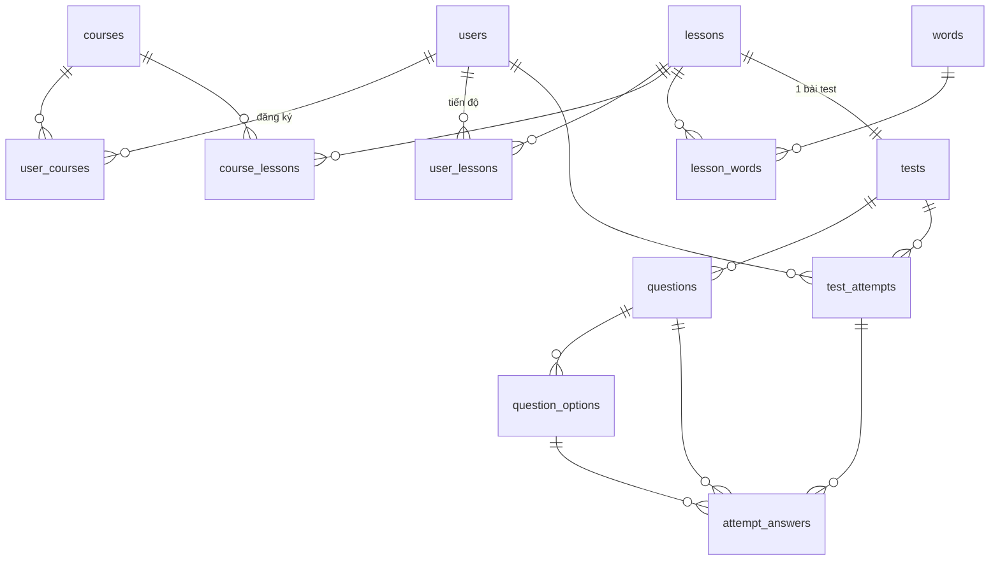

# Thiết kế CSDL (Phase 1)

PostgreSQL, TypeORM, **chỉ thay đổi schema qua migration** (`synchronize: false`).
Quy ước: bảng/cột `snake_case`, khoá chính `UUID` (`gen_random_uuid()`), mọi bảng có
`created_at`, `updated_at` (`TIMESTAMPTZ`, trigger `set_updated_at`).

## ERD



## Bảng

### users

| Cột           | Kiểu             | Ghi chú                            |
| ------------- | ---------------- | ---------------------------------- |
| id            | uuid PK          |                                    |
| email         | varchar(320)     | unique theo `LOWER(email)`         |
| password_hash | varchar(255)     | argon2                             |
| full_name     | varchar(100)     |                                    |
| avatar_url    | text null        |                                    |
| role          | enum `user_role` | `user` \| `admin`, mặc định `user` |

### courses

| Cột           | Kiểu             | Ghi chú                            |
| ------------- | ---------------- | ---------------------------------- |
| id            | uuid PK          |                                    |
| name          | varchar(255)     | index `LOWER(name)` để search      |
| description   | text null        |                                    |
| thumbnail_url | text null        |                                    |
| created_by    | uuid FK users    | admin tạo                          |
| deleted_at    | timestamptz null | soft delete (giữ lịch sử học viên) |

### lessons

| Cột         | Kiểu         |
| ----------- | ------------ |
| id          | uuid PK      |
| title       | varchar(255) |
| description | text null    |

### course_lessons (n-n course ↔ lesson)

| Cột       | Kiểu            | Ghi chú                    |
| --------- | --------------- | -------------------------- |
| course_id | uuid FK courses | PK (course_id, lesson_id)  |
| lesson_id | uuid FK lessons |                            |
| position  | int             | thứ tự lesson trong course |

### words

| Cột     | Kiểu         | Ghi chú      |
| ------- | ------------ | ------------ |
| id      | uuid PK      |              |
| content | varchar(255) | nội dung từ  |
| meaning | text         | nghĩa của từ |

### lesson_words (n-n lesson ↔ word)

| Cột       | Kiểu    | Ghi chú                 |
| --------- | ------- | ----------------------- |
| lesson_id | uuid FK | PK (lesson_id, word_id) |
| word_id   | uuid FK |                         |
| position  | int     |                         |

> **Đã chốt:** spec gốc ghi "bảng phụ lesson–word có trường `status` để kiểm tra từ đã học
> chưa", nhưng trạng thái "đã học" là **theo từng user**, nên `lesson_words` **không có cột
> `status`**. **"Từ đã học" = từ thuộc lesson mà user đã `pass`** (suy ra từ `user_lessons`).
> Nếu sau này cần đánh dấu từng từ riêng lẻ thì thêm bảng `user_words (user_id, word_id, status)`.

### tests (1 lesson – 1 test)

| Cột        | Kiểu           | Ghi chú                              |
| ---------- | -------------- | ------------------------------------ |
| id         | uuid PK        |                                      |
| lesson_id  | uuid FK unique |                                      |
| pass_score | int            | % điểm tối thiểu để pass, ví dụ `80` |

Phase 1 không giới hạn thời gian làm bài và không xáo trộn đáp án.

### questions / question_options

`questions`: `id`, `test_id`, `content`, `position`.
`question_options`: `id`, `question_id`, `content`, `is_correct` (bool), `position`.
Phase 1: mỗi câu **đúng 1 đáp án đúng** (single choice). Câu hỏi và đáp án luôn trả về theo
`position`.

### user_courses (đăng ký khoá học)

| Cột           | Kiểu                     | Ghi chú                               |
| ------------- | ------------------------ | ------------------------------------- |
| id            | uuid PK                  |                                       |
| user_id       | uuid FK                  | unique (user_id, course_id)           |
| course_id     | uuid FK                  |                                       |
| status        | enum `enrollment_status` | `pending` \| `approved` \| `rejected` |
| reviewed_by   | uuid FK users null       | admin duyệt                           |
| reviewed_at   | timestamptz null         |                                       |
| reject_reason | text null                |                                       |

Chuyển trạng thái:

- `pending` → `approved` (duyệt) hoặc `rejected` (từ chối).
- `approved` → `rejected` (**thu hồi**): user mất quyền truy cập course, nhưng `user_lessons` và
  `test_attempts` được giữ nguyên.
- `rejected` → `pending`: user đăng ký lại.

### user_lessons (trạng thái bài test của user theo lesson)

| Cột        | Kiểu                 | Ghi chú                               |
| ---------- | -------------------- | ------------------------------------- |
| user_id    | uuid FK              | PK (user_id, lesson_id)               |
| lesson_id  | uuid FK              |                                       |
| status     | enum `lesson_status` | `todo` \| `doing` \| `pass` \| `fail` |
| best_score | int null             |                                       |
| passed_at  | timestamptz null     |                                       |

Không có bản ghi = `todo`. Vì lesson có thể thuộc nhiều course, pass lesson ở course A
cũng tính là pass ở course B.

### test_attempts / attempt_answers

`test_attempts`: `id`, `user_id`, `test_id`, `status` (`doing` \| `submitted`), `score`
(%), `correct_count`, `total_questions`, `passed` (bool), `started_at`, `submitted_at`.
Mỗi user chỉ có tối đa 1 attempt `doing` cho mỗi test (partial unique index).

`attempt_answers`: `attempt_id`, `question_id`, `selected_option_id` (null = bỏ trống),
`is_correct`. PK (attempt_id, question_id).

## Tiến độ khoá học

```
progress = số lesson trong course mà user có status = pass / tổng số lesson của course
```

Tính bằng query (join `course_lessons` × `user_lessons`). Có thể cache trong Redis
`progress:{userId}:{courseId}` và xoá cache khi user nộp bài.
